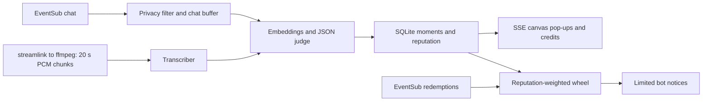

Credits Roll compares Twitch chat with a stream transcript, credits viewers whose messages changed the stream, rolls OBS end credits, and weights a Channel Points wheel.

# Credits Roll

## Try it in 60 seconds

Install Node 22.13 or later within Node 22 and npm 10 or later. Run:

```sh
npm ci && npm run demo
```

See [the rehearsal](http://localhost:3000/overlay/?preview=1), [the dashboard](http://localhost:3000/dashboard), or [the transparent OBS overlay](http://localhost:3000/overlay). Allow dependency installation to finish. The synthetic rehearsal lasts about 48 seconds. Expect five moments from four fictional viewers, followed by end credits. Keep the server open until Ctrl+C. Restart it to replay. Use `npm run demo -- --once` for a fast, finite run.

Use no credentials. The demo always selects fakes and an in-memory database. It makes no external requests even when credentials exist in the shell. Read [demo/README.md](demo/README.md) for its timeline. The fake transcriber decodes synthetic text; it does not recognize speech.

## What it does, as a story

You say, “I don't know what to build next… maybe the bridge?” A viewer, **@mapmaker**, types **“Try the northern bridge”** in chat. You answer out loud, “Good idea, going for the northern bridge.”

Credits Roll hears your broadcast audio and reads chat. It finds the adopted suggestion and shows **“@mapmaker moved the stream: Try the northern bridge”** on your OBS overlay. That moment builds the viewer's reputation. Click **Roll credits** at the end for movie-style viewer credits.

On an Affiliate or Partner channel, viewers can spend Channel Points on **Enter the Credits Wheel**. Reputation adds weight to the draw. Click **Spin the wheel** to choose a winner. The separate bot account announces the winner unless quiet mode is on. It never answers questions.

The **streamer account** identifies your channel and broadcast audio, including your microphone. The **bot account** is a different Twitch account. It reads chat and writes only allowed notices. Twitch reuses the browser's logged-in account: log out of Twitch or open the dashboard in a private window to authorize the bot. The dashboard shows each login and offers a separate Disconnect button.

## Try it in 2 minutes

Use the same `npm ci && npm run demo` command above. Do not connect Twitch or supply a key.

1. Open [the dashboard](http://localhost:3000/dashboard). Read **Start here**, then jump to **Try it without being live**. Open its **Preview** link in another window.
2. Let the automatic rehearsal finish (about 48 seconds). Click **Simulate a viewer message**. Read “Chat: @mapmaker: Try the northern bridge” in Activity.
3. Click **Simulate the streamer speaking** within 90 seconds. Watch the real overlay pop-up. Check **1 moment**, **1 viewer**, the transcript and “Moment found” in Activity.
4. Click **Roll credits** in the practice panel. Watch @mapmaker's end credit. Click **Spin the wheel** there to see the practice winner.

Practice runs synthetic inputs through the real pipeline with the offline FakeJudge. It uses a separate in-memory store, leaves live reputation alone, spends no Channel Points and sends nothing to Twitch. Stop live listening before practicing. Activity and transcript text expire from memory after 90 seconds. Practice controls work with development endpoints disabled.

If port 3000 is already in use, leave that app running and use `npm run demo -- --port=3001`. Open the dashboard URL printed by the demo. Its copy button uses that server's actual overlay URL.

## What earns credit

Credit needs evidence that a viewer's message changed what the streamer did or said. An adopted suggestion can be an **idea**, a useful fix an **assist**, or a joke or name that becomes part of the stream a **riff**. The judge estimates influence; it does not prove causation.

Start with 10 points for an idea, 8 for an assist and 6 for a riff. Multiply by the model's confidence and round to the nearest whole point. The dashboard reads these values from the scoring implementation. Earned points add to reputation.

Open **Credited viewers** on the dashboard. Choose **This stream** or **Last 72 hours**. Rows show total reputation, wheel weight, moment count and the last credited time, ordered by reputation. Expand a viewer to see the original chat quote, kind, confidence, awarded points, time and the streamer's adopting words. Copy the list with **Copy as text**. Activity can expire after 90 seconds; saved moment evidence remains available until the 72-hour retention deadline.

Each new moment saves at most 200 characters of canonical transcript text. Older moments cannot recover an excerpt that was never saved and say so. Both privacy commands erase the viewer's moment evidence and reputation. Full transcripts and audio remain off disk.

## What the reward is

Today the rewards are **recognition, reputation, an end-credits mention and a wheel chance**. Nothing is paid. End credits include every credited viewer and their chat quotes, ordered by earned points.

Reputation sets wheel weight: `min(20, 1 + floor(sqrt(points)))` for a credited entrant. An entrant without reputation gets weight 1. More weight improves the chance among viewers who entered; it does not guarantee a win. Entry requires redeeming **Enter the Credits Wheel** on an eligible Channel Points channel.

The prize is whatever the streamer saves in **Prize text**, beside **How credit and rewards work**. The default is **Choose the next challenge**. Describe and save the prize before accepting entries. The streamer delivers that prize; Credits Roll selects a winner and, unless quiet mode is on, asks the bot to announce it.

During a local server outage, the dashboard keeps the last received account and checklist state and shows **Reconnecting...**. It updates those statuses only after a successful response. Cached chat and evidence still expire at their privacy deadlines. Copied text is outside the app; manage those copies yourself.

## Run it on your channel

1. Register a confidential [Twitch application](https://dev.twitch.tv/docs/authentication/register-app/). Register exactly `http://localhost:3000/auth/callback` as its redirect URL. Keep the client secret private.
2. Create a separate Twitch bot account. Copy `.env.example` to `.env`. Set `TWITCH_CLIENT_ID` and `TWITCH_CLIENT_SECRET`. Leave `TWITCH_TOKEN_PATH` blank for `~/.credits-roll/tokens.json`, or set an absolute path outside this repository. Use a private local folder.
3. Install streamlink and ffmpeg and put both on PATH. Set `CHAT_SOURCE=live`, `JUDGE=openai` and `OPENAI_API_KEY`. Review the processing permissions described below before sending live data. Run `npm ci`, `npm run build`, then `npm start`.
4. Open [the dashboard](http://localhost:3000/dashboard). Follow **Start here**. Connect the streamer, then connect the different bot account; log out of Twitch or use a private window to change accounts. Save the language, threshold and prize settings. Copy the exact Browser Source URL from the dashboard into OBS at 1920 × 1080 with a transparent background. Go live on Twitch. Press **Start listening**.
5. Enable the wheel reward if your channel supports Channel Points. Uncheck **Quiet mode** if you want credits and winner announcements. Let viewers redeem **Enter the Credits Wheel**. Press **Roll credits** at the end, or let `stream.offline` trigger it. Press **Spin the wheel** to settle entries and select a winner. Complete both live verification streams below before recording the submission video.

Keep the app on loopback. Do not open router ports. EventSub uses outbound WebSockets. Keep one instance per channel and use one dedicated bot. If you change the port, change the registered callback and `TWITCH_REDIRECT_URI` too. The reward API requires an eligible Affiliate or Partner channel; see [Create Custom Rewards](https://dev.twitch.tv/docs/api/reference/#create-custom-rewards).

## How it works



Keep source chat in a bounded 90-second buffer. Compare a transcript window with preceding chat. For approximate live audio chunks, include messages inside the chunk and require evidence of spoken adoption. Reject low confidence, commands, instruction attacks and ambiguous identical suggestions. Take the viewer and quote from the canonical source message. Award each message at most once per stream.

Use the dashboard threshold, between 0.75 and 1. Score ideas with base 10, assists with base 8 and riffs with base 6. Multiply by confidence and round. Retain aggregate reputation until deletion or disconnect. Give a credited redeemer weight `min(20, 1 + floor(sqrt(points)))`. Give a redeemer without reputation weight 1.

Create the 100-point reward only after the streamer enables it. Keep it paused until listening starts. Admit one entry per viewer per stream. Draw one round per Twitch stream ID. Fulfill admitted entries when the draw settles. Cancel disabled, duplicate and opted-out entries. Persist redemption IDs and the selected round before settlement so retries reuse the draw. Refund unknown redemptions recovered after a gap rather than guessing their stream.

Use two EventSub connections: the bot token for chat and the streamer token for redemptions and stream-end events. Refresh expired tokens and retry one 401 response with a refreshed token. Validate authorizations at startup and hourly. Request only these scopes:

| Account  | Scopes                                                                  |
| -------- | ----------------------------------------------------------------------- |
| Streamer | `channel:bot`, `channel:manage:redemptions`, `channel:read:redemptions` |
| Bot      | `user:read:chat`, `user:write:chat`, `user:bot`                         |

Use Authorization Code OAuth, a browser-bound single-use state and an atomic token file outside git. Request file mode 0600 where supported. Do not treat Windows mode bits as a full ACL or encryption. Send secrets only in request bodies or authorization headers. See [Twitch OAuth](https://dev.twitch.tv/docs/authentication/getting-tokens-oauth/).

## How Codex built it

This same main Codex thread wrote the project code, tests, synthetic fixtures, canvas visuals and documentation from an empty repository during the hackathon. It built the offline pipeline first, then OAuth, the dashboard, live audio, redemptions, privacy controls and evaluation. Claude Code served only as a planning/review assistant outside the repository. It did not write repository files. Find the verified session ID and submission checklist in [SUBMISSION.md](SUBMISSION.md).

Run the checks:

```sh
npm test
npm run typecheck
npm run lint
npm run format:check
npm run build
npm run eval
```

Read [eval/README.md](eval/README.md) for input formats and metric definitions. Keep [eval/RESULTS.md](eval/RESULTS.md) numeric only. Treat its synthetic score as a development check, not a live quality claim.

## Prior work and external services

No project-specific prior work was imported. All project code and visuals were written during this hackathon. Standard npm libraries supply Fastify, SQLite, WebSocket transport, Vite and Vitest. Install their locked dependencies with `npm ci`.

| Optional dependency              | Enable it explicitly                                                                                               |
| -------------------------------- | ------------------------------------------------------------------------------------------------------------------ |
| Twitch OAuth and Helix           | Configure the application and connect both accounts.                                                               |
| Live EventSub and stream capture | Set `CHAT_SOURCE=live` and press Start listening.                                                                  |
| OpenAI judging and embeddings    | Set `JUDGE=openai` and `OPENAI_API_KEY`.                                                                           |
| OpenAI live transcription        | Set the key and start live capture. Live audio always uses the real transcriber; it skips cleanly without the key. |
| streamlink and ffmpeg            | Install them locally. Missing tools produce a dashboard skip message.                                              |
| Channel Points reward            | Enable it in dashboard settings on an eligible channel.                                                            |
| Chat announcements               | Disable Quiet mode. Explicit privacy confirmations remain enabled.                                                 |

Leave these integrations off for offline judging. Defaults select recorded input, fake judging, quiet mode and a disabled reward. Override model names only through the `OPENAI_*_MODEL` variables. Set `AUDIO_DELAY_MS` only after measuring HLS timing on your channel. Never put stream credentials into process arguments.

Use `npm run dev` for local development. Keep `ENABLE_DEV_ENDPOINTS=false` normally. Enable it explicitly to use `POST /dev/moment`, `POST /dev/transcript` or `POST /dev/credits`. Example:

```sh
curl -X POST http://localhost:3000/dev/moment -H 'Content-Type: application/json' -d '{"viewer":"syntheticviewer","quote":"Try the northern bridge","kind":"idea"}'
```

Read `/health`, `/api/state`, `/wheel` and `/events` for local state. Use `/dashboard/api/state` for setup status, counters, recent transcript windows and Activity. Dashboard writes require the local CSRF header and reject foreign origins. The OBS overlay never receives transcript text.

## Privacy and the Twitch Developer Agreement

The owner requested a durable, local-only credit ledger. It is JSON Lines at `%USERPROFILE%/.credits-roll/credits-ledger.jsonl` on Windows and `~/.credits-roll/credits-ledger.jsonl` elsewhere. Override it with `CREDITS_LEDGER_PATH`, which must resolve outside the repository. The app requests mode 0600; Windows ACLs still depend on the local account and folder.

Each record contains a schema version, credit ID, ISO time, stream/channel/viewer IDs, viewer login, kind, confidence, awarded points, a chat quote capped at 140 characters, an adoption excerpt capped at 200 characters, the judge model and a source-message ID for deduplication. No raw audio, full transcript, OAuth token or API key is included. The ledger is not sent to Twitch, OpenAI, a chain or any external service. Only the local dashboard can read it through the loopback API. Keep it out of version control and sharing tools.

Unlike the 72-hour SQLite evidence window, the ledger retains these short credit records until a privacy request or deliberate local deletion. Both `!optout` and `!forgetme` stop new credits and atomically rewrite the ledger without that viewer's records before attempting one confirmation. Privacy preferences remain in SQLite so restart/import cannot restore a forgotten viewer. Manage any copies or backups you made yourself. This storage choice does not grant Twitch data-processing permissions or certify agreement compliance.

To delete all saved credit history, stop your own local server when convenient, delete the ledger and the local SQLite database, and restart. Deleting only the ledger will import retained SQLite credits again. Deleting the SQLite database also removes opt-out preferences and settings; preserve those preferences if you still need to honor prior requests. Use the chat privacy commands for viewer-specific deletion. Never edit or share the live ledger while it is being written. Run one writer per ledger file. Appends atomically replace the old bytes with the same bytes plus one record; there is no automatic compaction or rotation. At 50 MB the dashboard warns instead of discarding history.

Tell viewers what recognition and external processing you enable. Honor `!optout` and `!forgetme` before judging. Both remove the viewer's moments, reputation, credits and wheel identity links immediately. Keep only the stable opt-out identifier and timestamps needed to honor the request and prevent duplicate confirmations. Queue cancellation of pending points entries. Attempt one reply to the command, including in quiet mode.

Keep raw audio and full transcripts off disk. Expire dashboard transcript windows and Activity from memory after 90 seconds. Save only the adoption excerpt attached to an accepted moment, capped at 200 characters. Clear both the quote and excerpt on a privacy request, disconnect or the 72-hour retention deadline. Filter expired evidence on every read, including the history panel and end credits. Keep a tick of deletion headroom. Do not retain expired chat or excerpts in backups. Preserve only the minimum non-text ledger needed for retries.

Disconnect either role to stop inputs, remove that role's OAuth tokens and clear collected channel data and active overlay state. The other account stays connected. Authorization revocation disconnects both roles and triggers local cleanup too. Preserve opt-out preferences. If Twitch is unreachable or authorization has already been revoked, review remote pending redemptions and disable the reward in Twitch yourself. Local deletion cannot reverse a fulfilled redemption or remove an announcement already sent.

Review the [Twitch Developer Services Agreement](https://legal.twitch.com/en/legal/developer-agreement/), especially its data use, third-party sharing and deletion provisions. Obtain the required permissions before sending Twitch-derived data to an external provider. The app does not grant those permissions or certify compliance. OpenAI mode sends candidate chat and transcripts; live transcription sends audio. Viewer identities are omitted from the judge's explicit metadata, but names may still occur in source text. Completion storage is disabled; provider-side processing policies still apply.

Never log tokens, authorization headers, raw live chat, audio or transcripts. Never commit real recordings. The only console moment text in the demo is fictional.

## Limits

- The owner reported one successful live recognition using Spanish stream audio and a chat message. This is owner-reported evidence, not an agent-observed live test. Automated tests use synthetic data and fakes. Real reward creation, redemption settlement, winner announcements and the new history/reconnect features still need live checks.
- Verify the dashboard and canvas in a real browser and OBS. The browser tool was unavailable during development.
- Expect HLS delay, chunk timing error and model mistakes. Recognition estimates influence; it does not prove causation. Tune timing and confidence on two authorized live streams.
- The fake judge uses English keywords. Spanish selects transcription language; it does not provide a Spanish dashboard or a validated Spanish matcher.
- The wheel supports one local channel and one round per stream. Disable the reward to cancel remaining queued entries. Keep the app running until settlement finishes. Review interrupted or already fulfilled entries manually if Twitch cannot update them.
- Bot sends are limited to credits, wheel winners and explicit privacy confirmations. The local limiter uses 20 attempts per 30 seconds and one per second per channel. Other apps using the same bot share Twitch's limits. Notices are marked before sending to prevent duplicates; an uncertain failure may lose a notice.
- Native SQLite installation may need build tools on platforms without a prebuilt binary. Use Node 22. Keep the token file and the local machine private.

Complete two owner-run streams: first verify chat influence, audio timing, the OBS pop-up, reward entry, winner and end credits; then restart the app and verify token refresh, duplicate protection, both privacy commands and deletion. Record what actually worked. Do not claim live verification from synthetic tests.
