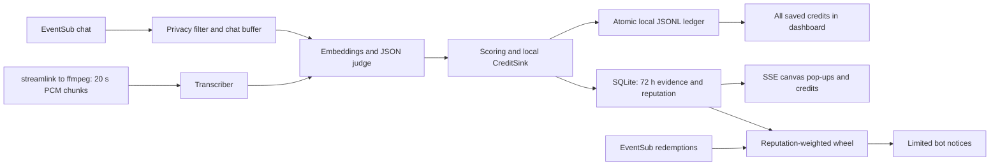

Credits Roll compares Twitch chat with a stream transcript, credits viewers whose messages changed the stream, rolls OBS end credits, and weights a Channel Points wheel.

# Credits Roll

## Try it in 60 seconds

Install Node 22.13 or later within Node 22 and npm 10 or later. Run:

```sh
npm ci && npm run demo
```

See [the rehearsal](http://localhost:3000/overlay/?preview=1), [the dashboard](http://localhost:3000/dashboard), or [the transparent OBS overlay](http://localhost:3000/overlay). Allow dependency installation to finish. The synthetic rehearsal lasts about 48 seconds. Expect five moments from four fictional viewers, followed by end credits. Keep the server open until Ctrl+C. Restart it to replay. Use `npm run demo -- --once` for a fast, finite run.

Use no credentials. The demo always selects fakes and an in-memory database. It makes no external requests even when credentials exist in the shell. Read [demo/README.md](demo/README.md) for its timeline. The fake transcriber decodes synthetic text; it does not recognize speech.

## What it does, as a story

You say, “I don't know what to build next… maybe the bridge?” A viewer, **@mapmaker**, types **“Try the northern bridge”** in chat. You answer out loud, “Good idea, going for the northern bridge.”

Credits Roll hears your broadcast audio and reads chat. It finds the adopted suggestion and shows **“@mapmaker moved the stream: Try the northern bridge”** on your OBS overlay. That moment builds the viewer's reputation. Click **Roll credits** at the end for movie-style viewer credits.

On an Affiliate or Partner channel, viewers can spend Channel Points on **Enter the Credits Wheel**. Reputation adds weight to the draw. Click **Spin the wheel** to choose a winner. The separate bot account announces the winner unless quiet mode is on. It never answers questions.

The **streamer account** identifies your channel and broadcast audio, including your microphone. The **bot account** is a different Twitch account. It reads chat and writes only allowed notices. Twitch reuses the browser's logged-in account: log out of Twitch or open the dashboard in a private window to authorize the bot. The dashboard shows each login and offers a separate Disconnect button.

## Try it in 2 minutes

Use the same `npm ci && npm run demo` command above. Do not connect Twitch or supply a key.

1. Open [the dashboard](http://localhost:3000/dashboard). Read **Start here**, then jump to **Try it without being live**. Open its **Preview** link in another window.
2. Let the automatic rehearsal finish (about 48 seconds). Click **Simulate a viewer message**. Read “Chat: @mapmaker: Try the northern bridge” in Activity.
3. Click **Simulate the streamer speaking** within 90 seconds. Watch the real overlay pop-up. Check **1 moment**, **1 viewer**, the transcript and “Moment found” in Activity.
4. Click **Roll credits** in the practice panel. Watch @mapmaker's end credit. Click **Spin the wheel** there to see the practice winner.

Practice runs synthetic inputs through the real pipeline with the offline FakeJudge. It uses a separate in-memory store, leaves live reputation alone, spends no Channel Points and sends nothing to Twitch. When listening is active, use **Stop listening** in the session banner before practicing. Start and practice errors appear beside the button used. Start explains missing authorization, accounts, streamlink, ffmpeg or an OpenAI key. An ended or skipped input releases the listening session. Activity and transcript text expire from memory after 90 seconds. Practice controls work with development endpoints disabled.

If port 3000 is already in use, leave that app running and use `npm run demo -- --port=3101`. Open the dashboard URL printed by the demo. Its copy button uses that server's actual overlay URL.

## What earns credit

Credit needs evidence that a viewer's message changed what the streamer did or said. An adopted suggestion can be an **idea**, a useful fix an **assist**, or a joke or name that becomes part of the stream a **riff**. The judge estimates influence; it does not prove causation.

Start with 10 points for an idea, 8 for an assist and 6 for a riff. Multiply by the model's confidence and round to the nearest whole point. The dashboard reads these values from the scoring implementation. Earned points add to reputation.

Open **All credits ever given** on the dashboard. Each row is one credit, newest first: viewer, stream, time, kind, confidence, points, the viewer's quote and the streamer's adopting words. Filter by viewer, stream or kind. Totals count the filtered credits, unique viewers and points. Use **Copy as text** or **Download CSV** for that selection. Exports re-read the local ledger, excluding forgotten viewers. Manage exported copies yourself.

The list survives server restarts and Activity expiry. On first startup, the app imports credits still present in SQLite without duplicates. It cannot recover credits already purged before this update. Legacy records say when an excerpt or judge model is unknown. Demo and practice credits use memory only; they never enter your personal ledger. The offline demo also keeps diagnostics in memory. Practice on the normal local server can appear in the temporary debug file, with a practice stream ID.

Each saved credit keeps at most 140 characters of the viewer's message and 200 characters of canonical adoption text. Both privacy commands erase that viewer's credit records and reputation. Full transcripts and audio remain off disk.

## How a moment is decided

Read the dashboard box with this name. Its numbers come from the matching implementation. These are proposed trial defaults for owner review; the app never auto-tunes from diagnostics.

- Ignore Nightbot, StreamElements, Streamlabs, Moobot, Fossabot, Wizebot, sery_bot, SoundAlerts and CommanderRoot by default. Edit **Ignored logins** or add comma-separated `IGNORED_LOGINS` in the environment. Matching is case insensitive. Connected streamer/bot accounts are always excluded by login and known Twitch ID. Recognized service IDs remain excluded after a rename within the running process. Bot badges are excluded; ordinary moderator/subscriber badges are not. Twitch does not provide a universal command-output flag, and its bot badge is conditional. See [Twitch's bot badge rules](https://dev.twitch.tv/docs/chat/#chatbot-badge-and-chat-identity).
- Keep messages at most 500 characters. Skip `!` commands and instruction attacks. Short reactions such as `lol`, `+1` and `f` never count. Unique short suggestions can still be judged. When different viewers repeat identical text, keep the earliest copy only if it exceeds 12 characters; timestamps decide, then message ID breaks ties. Select **Reject copies from different viewers** to restore the stricter policy. Earliest-copy attribution is a trial rule, not proof.
- Look back 90 seconds by default; save a value from 30 to 180. Keep the confidence threshold at 0.70 initially, or deliberately change it from 0.60 to 0.90. Lower thresholds may find weaker contributions and make more mistakes. Existing saved thresholds in range are preserved; old values above 0.90 migrate to 0.90. The slider shows your draft value; the explanation shows the saved value.
- Send at most 50 candidates to the judge after the bounded embedding pool. Topic similarity alone is insufficient. Validate returned IDs, kind and confidence even in [OpenAI JSON mode](https://developers.openai.com/api/docs/guides/structured-outputs?api-mode=chat). The model stays `gpt-4o-mini` unless explicitly configured.
- Leave **Experimental: consider chat after the reply** off initially. Earlier versions supported viewer-first evidence and uncertain order inside a live chunk. Enabling this option adds up to 10 seconds after the reply boundary and labels **viewer spoke first**, **streamer spoke first**, or **order uncertain within audio chunk** in the prompt and diagnostics. Streamer-first chat cannot cause an earlier action. It can qualify only as an experimental weak riff, capped at 0.65 confidence; a 0.70 threshold still drops it. The option can add up to ten seconds of waiting. Precise recorded windows use the reply start as the boundary; 20-second chunks use the chunk end. Practice remains an immediate viewer-first scene.

Inspect the private debug log before changing settings. Compare `confidence` with `threshold`; `rawConfidence` shows an uncapped judge score when available. Count `ignored-bot`, `duplicate`, `short-duplicate`, `not-in-window`, `candidate-limit`, `below-threshold` and `no-adoption-or-invalid-response`. Check `ordering` and `deltaMs`; positive values identify streamer-first tail candidates. `kept` means the matching filter passed, while storage may still reject a duplicate or opted-out credit. Inspect `dropped` in dashboard debug status for capacity loss. Review examples yourself; do not assume lower thresholds improve live precision.

## What the reward is

Today the rewards are **recognition, reputation, an end-credits mention and a wheel chance**. Nothing is paid. End credits include every credited viewer and their chat quotes, ordered by earned points.

Reputation sets wheel weight: `min(20, 1 + floor(sqrt(points)))` for a credited entrant. An entrant without reputation gets weight 1. More weight improves the chance among viewers who entered; it does not guarantee a win. Entry requires redeeming **Enter the Credits Wheel** on an eligible Channel Points channel.

The prize is whatever the streamer saves in **Prize text**, beside **How credit and rewards work**. The default is **Choose the next challenge**. Describe and save the prize before accepting entries. The streamer delivers that prize; Credits Roll selects a winner and, unless quiet mode is on, asks the bot to announce it.

During a local server outage, the dashboard keeps the last received account and checklist state and shows **Reconnecting...**. It updates those statuses only after a successful response. Cached Activity and transcript text still expire after 90 seconds. Saved ledger records remain until deletion. Copied text is outside the app; manage those copies yourself.

## Run it on your channel

Streamer authorization now requests clips, stream-marker, prediction and poll permissions together for the planned updates. Existing grants keep working for listening; the go-live checklist identifies each missing permission and offers **Reconnect streamer**. Requesting permission does not implement those future features. Get Users supplies the channel type. Channel Points, predictions and polls need Affiliate or Partner status; clips, markers and viewer recognition do not have that channel-type restriction. See [Twitch scopes](https://dev.twitch.tv/docs/authentication/scopes/) and [Get Users](https://dev.twitch.tv/docs/api/reference/#get-users).

1. Register a confidential [Twitch application](https://dev.twitch.tv/docs/authentication/register-app/). Register exactly `http://localhost:3000/auth/callback` as its redirect URL. Keep the client secret private.
2. Create a separate Twitch bot account. Copy `.env.example` to `.env`. Set `TWITCH_CLIENT_ID` and `TWITCH_CLIENT_SECRET`. Leave `TWITCH_TOKEN_PATH` blank for `~/.credits-roll/tokens.json`, or set an absolute path outside this repository. Use a private local folder.
3. Install streamlink and ffmpeg and put both on PATH. Set `CHAT_SOURCE=live`, `JUDGE=openai` and `OPENAI_API_KEY`. Review the processing permissions described below before sending live data. Run `npm ci`, `npm run build`, then `npm start`.
4. Open [the dashboard](http://localhost:3000/dashboard). Follow **Start here**. Connect the streamer, then the different bot account; log out of Twitch or use a private window to change accounts. Save the language, threshold and prize. Copy the Browser Source URL into OBS at 1920 × 1080, transparent. Leave **Auto-listen when I go live** enabled. With the server running, **Standby** waits for Twitch and starts capture when you go live. Start listening remains available manually.
5. Enable the wheel reward if your channel supports Channel Points. Uncheck **Quiet mode** if you want credits and winner announcements. Let viewers redeem **Enter the Credits Wheel**. Press **Roll credits** at the end, or let `stream.offline` trigger it. Press **Spin the wheel** to settle entries and select a winner. Complete both live verification streams below before recording the submission video.

Keep the app on loopback. Do not open router ports. EventSub uses outbound WebSockets. Keep one instance per channel and use one dedicated bot. If you change the port, change the registered callback and `TWITCH_REDIRECT_URI` too. The reward API requires an eligible Affiliate or Partner channel; see [Create Custom Rewards](https://dev.twitch.tv/docs/api/reference/#create-custom-rewards).

## How it works



Keep chat in a bounded buffer of at most 5,000 messages, with the saved lookback plus 60 seconds of alignment headroom for capture, transcription and the optional tail. Filter candidates against the transcript window itself. Compare preceding chat with spoken adoption. For approximate live chunks, include messages inside the chunk and label their order as uncertain. Take the viewer and quote from the canonical message. Award each message at most once per stream; the durable ledger also guards against replay after SQLite evidence expires.

Use the dashboard threshold, default 0.70 and range 0.60–0.90. Score ideas with base 10, assists with base 8 and riffs with base 6. Multiply by confidence and round. Retain aggregate reputation until deletion or disconnect. Give a credited redeemer weight `min(20, 1 + floor(sqrt(points)))`. Give a redeemer without reputation weight 1.

Create the 100-point reward only after the streamer enables it. Keep it paused until listening starts. Admit one entry per viewer per stream. Draw one round per Twitch stream ID. Fulfill admitted entries when the draw settles. Cancel disabled, duplicate and opted-out entries. Persist redemption IDs and the selected round before settlement so retries reuse the draw. Refund unknown redemptions recovered after a gap rather than guessing their stream.

Use two EventSub connections: the bot token for chat and the streamer token for redemptions and stream-end events. Refresh expired tokens and retry one 401 response with a refreshed token. Validate authorizations at startup and hourly. Request only these scopes:

| Account  | Scopes                                                                                                                                                                  |
| -------- | ----------------------------------------------------------------------------------------------------------------------------------------------------------------------- |
| Streamer | `channel:bot`, `channel:manage:redemptions`, `channel:read:redemptions`, `clips:edit`, `channel:manage:broadcast`, `channel:manage:predictions`, `channel:manage:polls` |
| Bot      | `user:read:chat`, `user:write:chat`, `user:bot`                                                                                                                         |

Use Authorization Code OAuth, a browser-bound single-use state and an atomic token file outside git. Request file mode 0600 where supported. Do not treat Windows mode bits as a full ACL or encryption. Send secrets only in request bodies or authorization headers. See [Twitch OAuth](https://dev.twitch.tv/docs/authentication/getting-tokens-oauth/).

## Capture recovery and the watchdog

Read the dashboard header before going live. **Listening** includes the age of the last received audio chunk and chat message. **Standby** means stream notifications are connected and the channel is offline. **Not listening** includes the missing requirement, current connection attempt or retry reason. A cached header says **Last known** during reconnects. Get `/health` for `autoListen`, `listening`, `lastAudioAt` and `lastChatAt`; times are local receipt timestamps in milliseconds, or null before input arrives. A restarted process never restores an old Listening claim.

Use **Go-live checklist** to inspect both logins, the verified `broadcaster_type`, granted scopes, overlay connection and live audio status. A browser preview also connects to SSE; confirm that the connected source is OBS. Missing future scopes show **Reconnect streamer** without breaking current listening. Affiliate-only live controls stay hidden until eligibility is verified; the practice wheel stays available.

If the supervisor exhausts its restart budget, it saves `supervisor-alert.json` next to the private ledger (override `CR_SUPERVISOR_ALERT_PATH`). It contains only an alert ID, UTC time, reason and numeric restart limit. Keep this path separate from tokens, ledger and diagnostics. The alert appears after the server can run again and stays until **Acknowledge saved alert**. An unavailable server cannot serve a new dashboard alert; the open page shows Reconnecting and its last received state. Delete the status file or acknowledge it to remove it.

Each streamlink and ffmpeg pipe has a 60-second no-data guard. A stalled capture kills its two owned children and retries after one second. The capture queue holds at most three complete 20-second chunks; slow processing can skip an old buffered chunk and show a status message. Stop and shutdown abort provider work and destroy capture pipes. OpenAI requests, including response-body reads, have a 30-second aborting deadline. A provider that ignores cancellation is still bounded at the interface.

Every minute the server samples event-loop delay and logs numeric max/p99 lag when the max exceeds 500 ms. A separate worker probes the real loopback `/health` endpoint every five seconds, with a five-second probe limit. If no valid answer arrives for 90 seconds, it writes `WATCHDOG` directly to stderr and terminates its own Node process non-zero, even if the main thread is blocked. Startup replays retained ledger-only credits into SQLite idempotently to repair an interrupted ledger/SQLite commit; it sends no duplicate pop-up. A forced process or machine failure can interrupt remote reward settlement; inspect pending redemptions in Twitch.

Start normally with `npm start`, or opt into the supervisor from a Node 22 PowerShell terminal:

```powershell
powershell.exe -NoProfile -ExecutionPolicy Bypass -File .\scripts\run-forever.ps1
```

The supervisor restarts non-zero exits at most five times in a sliding ten-minute window, waits one second between attempts, and stops on a clean exit or operator interrupt. It runs the built server with the existing `.env`. It never rebuilds or changes credentials. Keep one server instance. Auto-listen defaults on: after startup and each EventSub reconnect, the app checks Get Streams and resumes capture if the channel is already live. It keeps a separate streamer-token WebSocket for online/offline events. HLS startup failures receive six retries, twenty seconds after each failure; capture waits still have the existing sixty-second bound. Repeated online notifications for the same stream cannot start another session. Offline rolls credits once and returns to standby.

Choose **Stop listening** to cancel capture and pending retries. This pause is saved for the current Twitch stream across server restarts, so practice remains available. Start listening resumes that stream; a new stream can start automatically. Turning Auto-listen off prevents automatic starts, without interrupting a session already requested. The original 41-minute hang remains unexplained. Recovery tests do not establish live stability.

## Start automatically after Windows logon

Run this yourself from the installed live copy, in a Node 22 PowerShell terminal. The installer is per-user and needs no stored password. It registers an **at logon** task; it does not start a server during installation. It runs only while you are signed in and the computer is awake. Start one supervisor manually for the current sign-in; do not keep a second server open.

```powershell
Set-Location 'C:\\Users\\lxhxr\\credits-roll-live'
$node22 = (Get-Command node.exe -CommandType Application).Source
& $node22 --version # Must report v22.13 or newer within v22.
powershell.exe -NoProfile -ExecutionPolicy Bypass -File .\\scripts\\install-autostart.ps1 -Install -NodePath $node22
# For this sign-in only, after stopping any existing server yourself:
powershell.exe -NoProfile -ExecutionPolicy Bypass -File .\\scripts\\run-forever.ps1 -NodePath "$env:LOCALAPPDATA\\CreditsRoll\\runtime\\node.exe"
```

The task copies the selected Node executable to the stable private path `%LOCALAPPDATA%\\CreditsRoll\\runtime\\node.exe`; it does not depend on a temporary download folder or npm. Its private `autostart.json` contains only the installation path, stable Node path and discovered streamlink/ffmpeg directories. The task uses the current user's interactive identity, limited privilege, a hidden window, no execution-time limit and IgnoreNew for overlapping task runs. Its supervisor owns the five-restart budget; Task Scheduler adds no restart policy. Re-run installation from the new location if you move the live copy or change tools. If Windows policy rejects task registration, use the manual supervisor command; no task installation was performed or verified by Codex.

Remove the future logon trigger yourself:

```powershell
powershell.exe -NoProfile -ExecutionPolicy Bypass -File .\\scripts\\install-autostart.ps1 -Uninstall
```

Uninstall leaves running servers, credentials, credit history and the stable runtime alone. It does not stop a process. Remove the private autostart settings/runtime yourself after uninstall if no longer needed. Do not run this installer from a throwaway verification clone.

## How Codex built it

This same main Codex thread wrote the project code, tests, synthetic fixtures, canvas visuals and documentation from an empty repository during the hackathon. It built the offline pipeline first, then OAuth, the dashboard, live audio, redemptions, privacy controls and evaluation. Claude Code served only as a planning/review assistant outside the repository. It did not write repository files. Find the verified session ID and submission checklist in [SUBMISSION.md](SUBMISSION.md).

Run the checks:

```sh
npm test
npm run typecheck
npm run lint
npm run format:check
npm run build
npm run eval
```

Always repeat verification in fresh clones with `core.autocrlf=true` and `false`. For a real-browser smoke check, set `BROWSER_PATH` to an installed Edge or Chrome executable and `PORT=3101`, then run `npm run test:browser`. Without that executable the script prints a clear skip. It starts an isolated local test server and a fresh headless browser profile. It makes no Twitch or OpenAI calls. In a throwaway clone, run `npm run test:fetch-mutation` and `npm run test:bot-mutation`. They prove that removing the fetch fix or bypassing bot filtering fails the targeted tests, then restore exact bytes. Run `npm run test:watchdog` for the source worker and, after building, `npm run test:watchdog -- --compiled` for the compiled worker. These terminate only a deliberately blocked disposable test child, using a compressed one-second test deadline; production uses 90 seconds.

Read [eval/README.md](eval/README.md) for input formats and metric definitions. Keep [eval/RESULTS.md](eval/RESULTS.md) numeric only. Treat its synthetic score as a development check, not a live quality claim.

## Prior work and external services

No project-specific prior work was imported. All project code and visuals were written during this hackathon. Standard npm libraries supply Fastify, SQLite, WebSocket transport, Vite and Vitest. Install their locked dependencies with `npm ci`.

| Optional dependency              | Enable it explicitly                                                                                               |
| -------------------------------- | ------------------------------------------------------------------------------------------------------------------ |
| Twitch OAuth and Helix           | Configure the application and connect both accounts.                                                               |
| Live EventSub and stream capture | Set `CHAT_SOURCE=live`, connect both accounts and keep Auto-listen enabled, or start manually.                     |
| OpenAI judging and embeddings    | Set `JUDGE=openai` and `OPENAI_API_KEY`.                                                                           |
| OpenAI live transcription        | Set the key and start live capture. Live audio always uses the real transcriber; it skips cleanly without the key. |
| streamlink and ffmpeg            | Install them locally. Missing tools produce a dashboard skip message.                                              |
| Channel Points reward            | Enable it in dashboard settings on an eligible channel.                                                            |
| Chat announcements               | Disable Quiet mode. Explicit privacy confirmations remain enabled.                                                 |

Leave these integrations off for offline judging. Defaults select recorded input, fake judging, quiet mode and a disabled reward. Override model names only through the `OPENAI_*_MODEL` variables. Set `AUDIO_DELAY_MS` only after measuring HLS timing on your channel. Never put stream credentials into process arguments.

Use `npm run dev` for local development. Keep `ENABLE_DEV_ENDPOINTS=false` normally. Enable it explicitly to use `POST /dev/moment`, `POST /dev/transcript` or `POST /dev/credits`. Example:

```sh
curl -X POST http://localhost:3000/dev/moment -H 'Content-Type: application/json' -d '{"viewer":"syntheticviewer","quote":"Try the northern bridge","kind":"idea"}'
```

Read `/health`, `/api/state`, `/wheel` and `/events` for local state. Use `/dashboard/api/state` for setup status, counters, recent transcript windows and Activity. Use `/dashboard/api/ledger` for the local saved-credit list. Dashboard writes require the local CSRF header and reject foreign origins. The OBS overlay never receives transcript text.

## Privacy and the Twitch Developer Agreement

The owner requested temporary local diagnostics, enabled by default for this trial. **Debug log** in dashboard settings stops new entries when unchecked; save settings to apply it. **Download debug log** exports a local copy and **Clear debug log** erases the working log. The default is `debug-log.jsonl` beside the credit ledger, normally `~/.credits-roll/debug-log.jsonl` (`%USERPROFILE%` on Windows). `CR_DEBUG_LOG_PATH` must resolve outside the repository. The app requests mode 0600 where supported. No diagnostic data is sent to a provider or printed to the server console.

Each chat entry stores an ISO observation time, message ID, viewer ID/login, message time, up to 200 characters of text, and its intake decision: ignored bot, command, too long, duplicate delivery, outside the buffer window or candidate. A candidate is eligible for consideration, not necessarily credited. Each transcript entry keeps window/stream IDs, timing and at most 300 characters. Each judge entry keeps canonical message/viewer IDs, window/stream IDs, kind, confidence, raw confidence when available, kept/dropped, reason, threshold, ordering and a signed delta in milliseconds from the reply boundary. Common credential-like strings are redacted; do not paste credentials into chat. Full audio and transcripts remain off disk.

Diagnostics expire within 24 hours, with startup and hourly purges and deletion headroom. The working file never exceeds 20 MB; capacity discards the oldest entries and reports drops. Writes are batched asynchronously. Both privacy commands erase that viewer's chat and judge entries before a confirmation; all diagnostic transcript snippets are also erased because speech may quote a viewer. Privacy commands and messages from opted-out viewers are not recorded. Copies downloaded by the owner require separate deletion. Treat this temporary log as private Twitch data under the Developer Agreement; its local storage does not grant processing permissions or certify compliance.

The owner requested a durable, local-only credit ledger. It is JSON Lines at `%USERPROFILE%/.credits-roll/credits-ledger.jsonl` on Windows and `~/.credits-roll/credits-ledger.jsonl` elsewhere. Override it with `CREDITS_LEDGER_PATH`, which must resolve outside the repository. The app requests mode 0600; Windows ACLs still depend on the local account and folder.

Each record contains a schema version, credit ID, ISO time, stream/channel/viewer IDs, viewer login, kind, confidence, awarded points, a chat quote capped at 140 characters, an adoption excerpt capped at 200 characters, the judge model and a source-message ID for deduplication. No raw audio, full transcript, OAuth token or API key is included. The ledger is not sent to Twitch, OpenAI or any external service. Only the local dashboard can read it through the loopback API. Keep it out of version control and sharing tools.

Unlike the 72-hour SQLite evidence window, the ledger retains these short credit records until a privacy request or deliberate local deletion. Both `!optout` and `!forgetme` stop new credits and atomically rewrite the ledger without that viewer's records before attempting one confirmation. Privacy preferences remain in SQLite so restart/import cannot restore a forgotten viewer. Manage any copies or backups you made yourself. This storage choice does not grant Twitch data-processing permissions or certify agreement compliance.

To delete all saved credit history, first settle or refund pending wheel entries, then choose **Disconnect streamer** on your local dashboard. That clears collected SQLite channel data while preserving privacy preferences and settings. Stop your own server when convenient, delete the JSONL file at the configured ledger path, and restart. Reconnect the streamer account. Deleting only the ledger while SQLite still contains moments will import those moments again. Use the chat privacy commands for viewer-specific deletion. Preserve the SQLite opt-out preferences. Never edit or share the live ledger while it is being written. Run one writer per ledger file. Appends atomically replace the old bytes with the same bytes plus one record; there is no automatic compaction or rotation. At 50 MB the dashboard warns instead of discarding history.

Tell viewers what recognition and external processing you enable. Honor `!optout` and `!forgetme` before judging. Both remove the viewer's moments, reputation, credits and wheel identity links immediately. Keep only the stable opt-out identifier and timestamps needed to honor the request and prevent duplicate confirmations. Queue cancellation of pending points entries. Attempt one reply to the command, including in quiet mode.

Keep raw audio and full transcripts off disk. Expire dashboard transcript windows and Activity from memory after 90 seconds. SQLite quotes and adoption excerpts expire within 72 hours and are filtered on reads, including current-stream end credits. The owner-requested JSONL ledger is the explicit exception: short credit records stay until a privacy request or local deletion. Do not copy expired SQLite evidence into backups. Keep the durable ledger and any manual exports private.

Disconnect either role to stop inputs, remove that role's OAuth tokens and clear collected SQLite channel data and active overlay state. The saved JSONL ledger remains local; follow the deletion instructions above to erase it. The other account stays connected. Authorization revocation disconnects both roles and triggers local cleanup too. Preserve opt-out preferences. If Twitch is unreachable or authorization has already been revoked, review remote pending redemptions and disable the reward in Twitch yourself. Local deletion cannot reverse a fulfilled redemption or remove an announcement already sent.

Review the [Twitch Developer Services Agreement](https://legal.twitch.com/en/legal/developer-agreement/), especially its data use, third-party sharing and deletion provisions. Obtain the required permissions before sending Twitch-derived data to an external provider. The app does not grant those permissions or certify compliance. OpenAI mode sends candidate chat and transcripts; live transcription sends audio. Viewer identities are omitted from the judge's explicit metadata, but names may still occur in source text. Completion storage is disabled; provider-side processing policies still apply.

Never log tokens or authorization headers. Keep raw live chat, audio and full transcripts out of console logs. The owner-approved bounded local debug snippets are the explicit temporary exception described above. Never commit real recordings or diagnostics. The only console moment text in the demo is fictional.

## Limits

- The owner reported one successful live recognition using Spanish stream audio and a chat message. This is owner-reported evidence, not an agent-observed live test. Automated tests use synthetic data and fakes. Real reward creation, redemption settlement, winner announcements and the new history/reconnect features still need live checks.
- A headless installed Edge/Chrome smoke check exercises dashboard loading, native fetch, listening controls, inline errors, practice, ledger filters, CSV, privacy, matching settings and debug download/clear. Human visual review and OBS rendering still need owner checks.
- Expect HLS delay, chunk timing error and model mistakes. Recognition estimates influence; it does not prove causation. Tune timing and confidence on two authorized live streams.
- The fake judge uses English keywords. Spanish selects transcription language; it does not provide a Spanish dashboard or a validated Spanish matcher.
- The wheel supports one local channel and one round per stream. Disable the reward to cancel remaining queued entries. Keep the app running until settlement finishes. Review interrupted or already fulfilled entries manually if Twitch cannot update them.
- Bot sends are limited to credits, wheel winners and explicit privacy confirmations. The local limiter uses 20 attempts per 30 seconds and one per second per channel. Other apps using the same bot share Twitch's limits. Notices are marked before sending to prevent duplicates; an uncertain failure may lose a notice.
- The ledger supports one writer. It loads history into memory and copies the file during each atomic append. Large histories cost more memory and write time; the 50 MB warning does not remove records.
- Native SQLite installation may need build tools on platforms without a prebuilt binary. Use Node 22. Keep the token file and the local machine private.

Complete two owner-run streams: first verify chat influence, audio timing, the OBS pop-up, reward entry, winner and end credits; then restart the app and verify token refresh, duplicate protection, both privacy commands and deletion. Record what actually worked. Do not claim live verification from synthetic tests.
